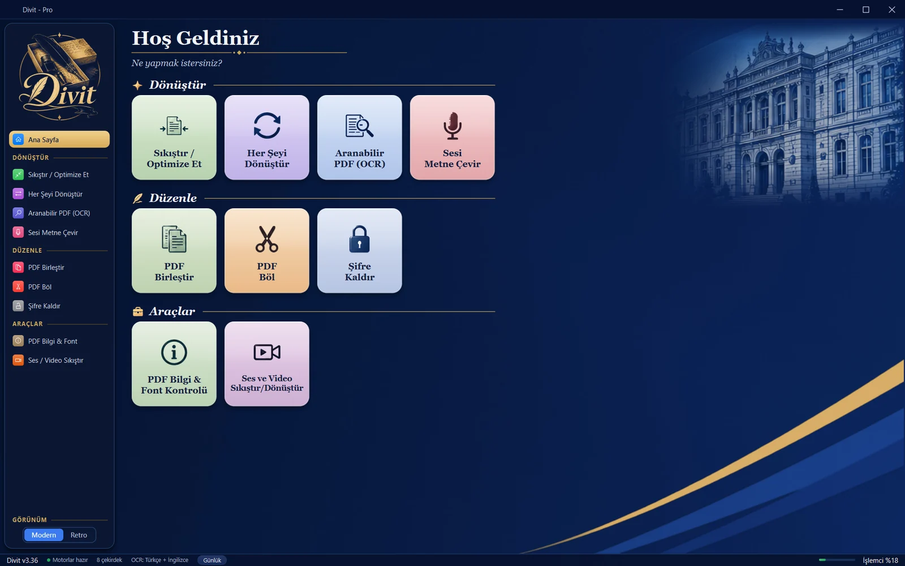
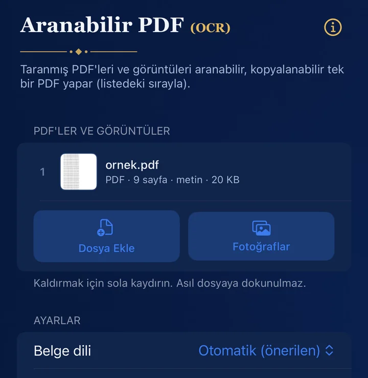
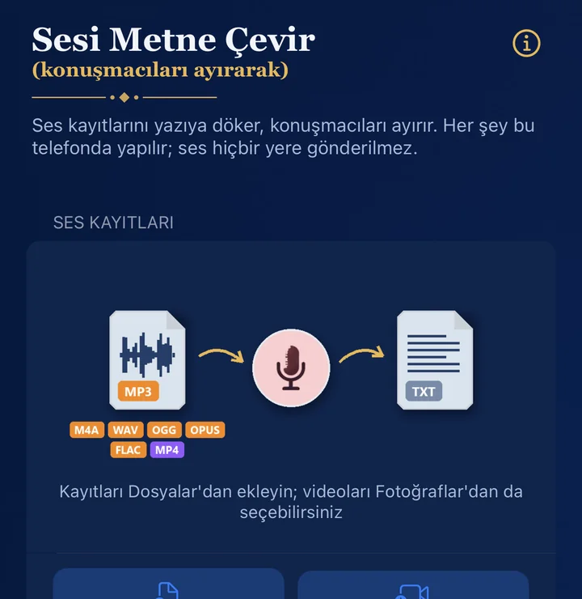
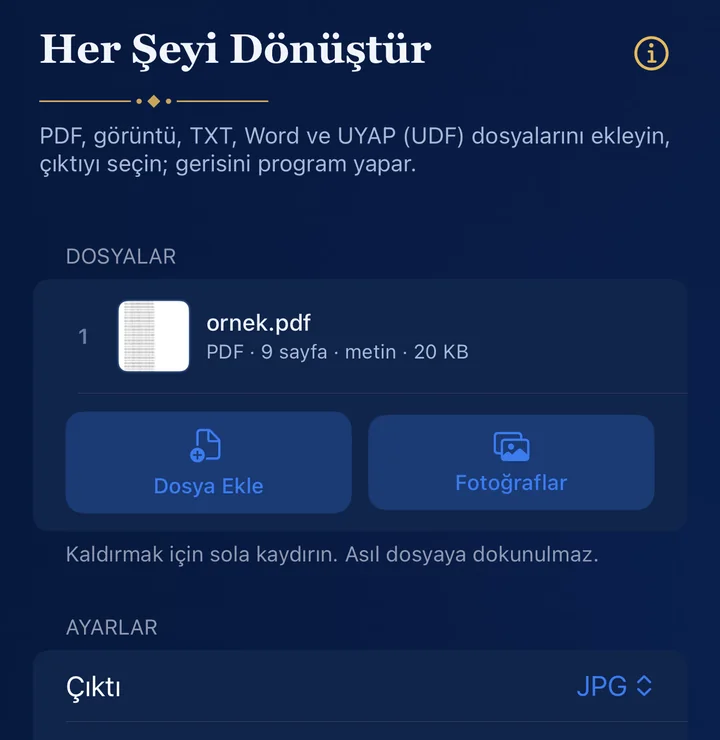

<h1 align="center">Academic PDFWorks</h1>

<b>PDF, OCR, UYAP (UDF), Word, Excel ve ses araçları tek programda.</b> 
Her şey kendi bilgisayarınızda ya da telefonunuzda yapılır; dosyalarınız hiçbir yere gönderilmez.

  <a href="https://whosaidreal.github.io/academic-pdfworks/indir.html"><b>⬇ İndir</b></a> ·
  <a href="https://whosaidreal.github.io/academic-pdfworks/">Tanıtım sayfası</a> ·
  <a href="https://whosaidreal.github.io/academic-pdfworks/destek.html">Destek</a> ·
  <a href="https://whosaidreal.github.io/academic-pdfworks/gizlilik.html">Gizlilik</a>

Bu depo Academic PDFWorks'ün herkese açık sayfalarını ve Windows sürümlerini barındırır. Kaynak kodu burada değildir.

## İndir

| | |
|---|---|
| **Windows, kurulum dosyası** | [AcademicPDFWorks_Setup.exe](https://github.com/whosaidreal/academic-pdfworks/releases/latest/download/AcademicPDFWorks_Setup.exe): yönetici izni istemez, Başlat menüsüne ekler |
| **Windows, taşınabilir** | [AcademicPDFWorks_Portable.exe](https://github.com/whosaidreal/academic-pdfworks/releases/latest/download/AcademicPDFWorks_Portable.exe): kurulmadan, tek dosya olarak çalışır |
| **Windows, Microsoft Store** | çok yakında |
| **iPhone, App Store** | çok yakında |

Windows 10 ve 11, 64 bit; iPhone'da iOS 16.4 ve üzeri. Dosyalar kod imzalı değil: Windows "Windows bilgisayarınızı
korudu" derse **Ek bilgi › Yine de çalıştır**. Her sürümün SHA-256 özeti [sürüm notunda](https://github.com/whosaidreal/academic-pdfworks/releases) yazar.

## Neler yapar?

- **Her Şeyi Dönüştür:** PDF, Word, Excel, UYAP (UDF), görüntü ve metin dosyalarını birbirine çevirir; yazı tipleri,
  tablolar ve sayfa düzeni korunur.
- **Aranabilir PDF (OCR):** taranmış belgeleri ve fotoğrafları aranabilir, kopyalanabilir PDF yapar (Türkçe ve İngilizce).
- **Sesi Metne Çevir:** ses kayıtlarını ve WhatsApp sesli mesajlarını konuşmacıları ayırarak yazıya döker.
- **Sıkıştır / Optimize Et, Böl, Birleştir, Şifre Kaldır:** kayıpsız; klasörleri topluca işler.
- **PDF Bilgi ve Font Kontrolü:** tez ve dergi gönderimleri için "bütün yazı tipleri gömülü mü?" denetimi.
- **Ses ve video sıkıştırma, belge fotoğraflarını düzeltme;** Modern ve Retro görünüm.

  
  
  

Hesap, reklam ya da izleme yoktur. Arayüz Türkçedir. UYAP, T.C. Adalet Bakanlığı'nın sistemidir; Academic PDFWorks
Bakanlıkla ya da UYAP ile bağlantılı değildir.

Academic PDFWorks, açık kaynaklı bileşenleri (Qt / PySide6, Tesseract OCR, pikepdf, Pillow ve diğerleri) değiştirmeden
içerir. Lisansları: [THIRD_PARTY_NOTICES.txt](THIRD_PARTY_NOTICES.txt).

---

**English.** This repository hosts the public pages and the Windows releases of Academic PDFWorks; the source code is
not here. Academic PDFWorks is a free PDF, OCR, UYAP (UDF), Word, Excel and audio toolkit for Windows and iPhone: it makes
scanned documents searchable, converts between document formats while keeping the layout, and transcribes recordings
with speaker separation. Everything runs on your own device. The interface is in Turkish.
[Download](https://whosaidreal.github.io/academic-pdfworks/indir.html) ·
[Support](https://whosaidreal.github.io/academic-pdfworks/destek.html#en) ·
[Privacy](https://whosaidreal.github.io/academic-pdfworks/gizlilik.html#en).
The installer is not code-signed, so Windows may warn on first start (More info › Run anyway). The app bundles
unmodified open-source components; see [THIRD_PARTY_NOTICES.txt](THIRD_PARTY_NOTICES.txt) for their licences.
